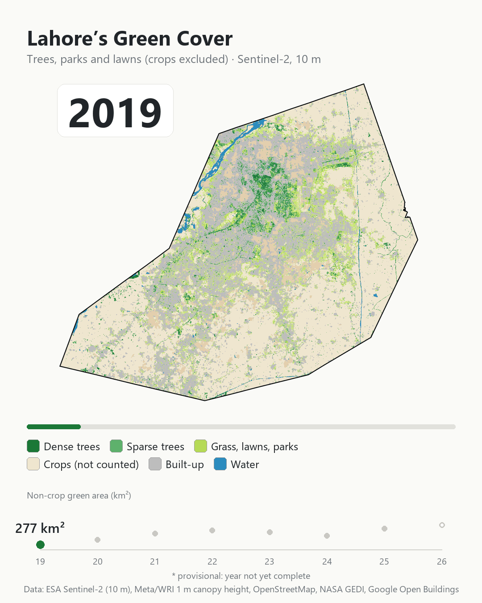
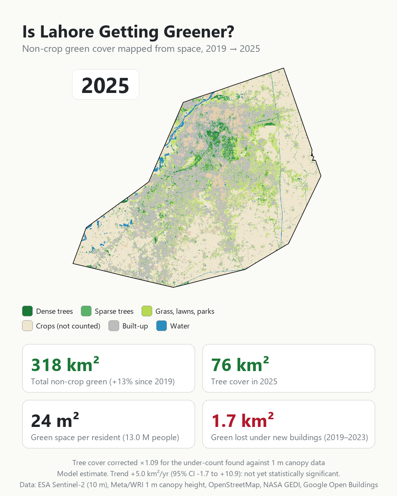
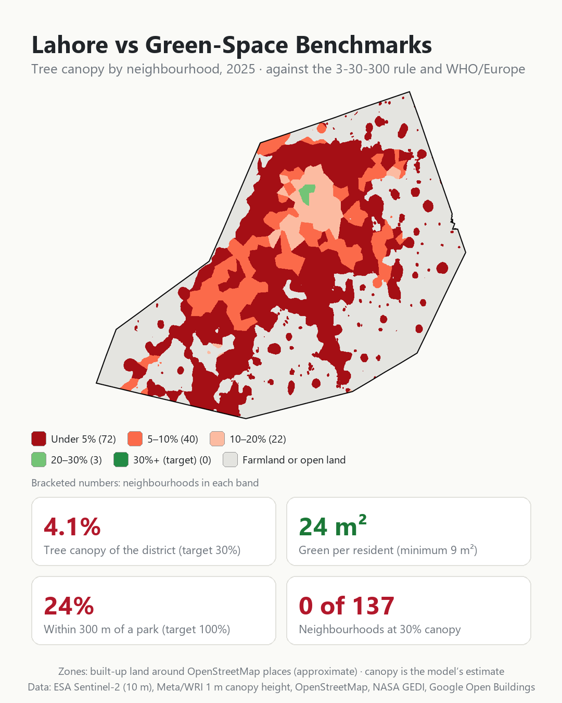
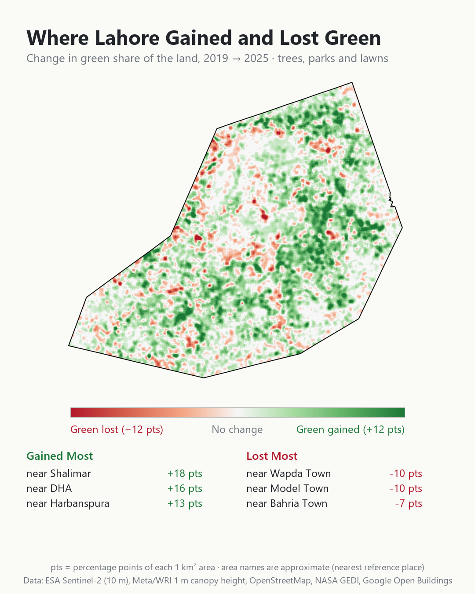

# Lahore Non-Crop Green Cover, 2019–2026

**Is Lahore getting greener?** This project maps every tree, lawn, park and patch of grass in Lahore district for every year from 2019 to 2026, using free Sentinel-2 satellite images at 10 m resolution. Crops are deliberately left out. Each estimate is then checked against independent data.

**▶ [Open the interactive app](https://lahore-green-cover-2000-2026.projects.earthengine.app/view/lahore-green-cover-2019-2026)**: yearly maps, change maps, neighbourhood benchmarks and the verification results. It works on phones too.

---

## Key findings

| | 2019 | 2025 | Change |
|---|---|---|---|
| Tree cover | 62.9 km² | 69.8 km² | +6.9 km² (+11%) |
| Grass, lawns, parks | 213.7 km² | 242.1 km² | +28.4 km² (+13%) |
| **Total non-crop green** | **276.6 km²** | **311.9 km²** | **+35.3 km² (+13%)** |
| Share of the district | 16.3% | 18.4% | +2.1 points |

- Lahore's non-crop green cover **grew by about 35 km² between 2019 and 2025**, and both NASA's GEDI space laser and Google Open Buildings point the same way.
- The rise is **not yet a statistically established trend**: 7 years of data (2019–2025) is too short, and year-to-year swings are large and partly follow rainfall (r = 0.62).
- Green is still being lost to construction. **21.4 km² was newly built between 2019 and 2023**, and green cover fell on 77% of that land.
- The model under-counts tree area by about 9% of itself, mostly small trees. Allowing for this, 2025 tree cover is about 76 km², not 70 km². That's a change of less than half a percentage point of the district.

### Lahore against urban green-space benchmarks (2025)

| Benchmark | Lahore | Target |
|---|---|---|
| Tree canopy, share of the district (3-30-300 rule) | 4.1% | 30% per neighbourhood |
| Non-crop green per resident | 24 m² | commonly quoted minimum 9 m², ideal 50 m² |
| Residents within 300 m of a park of at least 0.5 ha | 24% | 100% (WHO/Europe) |
| Neighbourhoods meeting 30% canopy | 0 of 137 | all |

The district share includes farmland, so the fair comparison with the 30% target is neighbourhood by neighbourhood. Even the leafiest areas stay below it: Zaman Park (25%), Mayo Gardens (24%) and GOR (24%). Bagrian, DHA Phase 9 Prism and Chah Miran have the least canopy, at under 2%.

---

## How it works

**Data:** Sentinel-2 surface reflectance (ESA/Copernicus), cloud-masked with Google Cloud Score+ plus a haze filter. Each year uses three seasons: February–March, May–June and early October.

1. **Trees.** A random-forest model estimates the share of every 10 m pixel covered by trees. It's trained on the Meta/WRI 1 m global canopy-height map (trees of 3 m or taller).
2. **Grass, lawns and parks.** This is the share of each pixel that stays green all year and isn't trees. Crops are removed with a classifier trained and tested on OpenStreetMap parks, lawns and golf courses.
3. **Crops are excluded** because wheat and rice are green for only a few months.
4. **Consistency between years.** Images are normalised to 2021. Remaining drift is measured and removed on land that can't change, such as dense old built-up areas and permanent water.
5. **Trend.** Mann-Kendall test with Sen's slope and a 95% confidence interval.

### How we checked it

Ten scored checks test the model against data it was **not** trained on:

| Check | Result |
|---|---|
| C1 Clear-image coverage across the city | ✅ |
| C2 Stable in protected forests and stable canopy | ✅ |
| C3 Tree share vs held-out 1 m canopy | ⚠ about 9% under-count, R² 0.41 |
| C4 Grass found in held-out OSM parks; little false grass in crops | ✅ |
| C5 False change on land that can't change | ✅ about 1% |
| C6 Robust to model settings | ✅ +6% to +14% across variants |
| C7 Three methods agree on direction | ⚠ +13% to +76% |
| C8 Grass/crop classifier accuracy | ✅ |
| C9 Trend and 95% confidence interval | ⚠ positive, not significant (7 years is too short) |
| C10 Independent: NASA GEDI laser canopy heights | ✅ r = 0.62 |
| C11 Independent: green lost where new buildings appeared | ✅ |

**Verdict: partly supported.** The direction is independently confirmed, but 7 years of data (2019–2025) is too short to prove a trend. Without field visits, the best this method can reach is "well supported", not "field-verified".

---

## Repository contents

| Path | What it is |
|---|---|
| `scripts/lahore_v7_A_build.js` | Earth Engine script A: trains the models and saves one map per year as assets (run once) |
| `scripts/lahore_v7_B_app.js` | Earth Engine script B: the interactive app (yearly maps, change, timelapse, benchmarks, verification) |
| `data/lahore_osm_green.zip` | 1,731 OpenStreetMap green-space polygons for Lahore (shapefile), used for training and testing |
| `graphics/` | Timelapse GIF, summary card and hotspot map |
| `tools/build_visuals.py` | Builds the graphics from the app's exported data (Python and Pillow) |
| `tools/osm_to_shp.py` | Converts an OpenStreetMap Overpass download into the shapefile above |

## Run it yourself

1. Get a free [Google Earth Engine](https://earthengine.google.com/) account and a Cloud project.
2. Upload `data/lahore_osm_green.zip` as a table asset named `lahore_osm_green` (Assets → New → Shape files).
3. In `lahore_v7_A_build.js`, set `ASSET_FOLDER` to your project. Run it with `STEP = 1`, start the two export tasks, then run it with `STEP = 2` and start the yearly exports.
4. Open `lahore_v7_B_app.js`, set the same `ASSET_FOLDER`, and click **Run**.

## Caveats

- This is a research estimate from free satellite data, not an official statistic.
- 2026 is provisional because the year isn't complete.
- Neighbourhood names and zones are approximate catchments around OpenStreetMap place points, not official boundaries.
- Parks are OpenStreetMap parks, gardens and recreation grounds of at least 0.5 ha. Some may not be open to the public.
- Population figures are GHSL 2025 model estimates.

## Data sources and credits

ESA/Copernicus Sentinel-2 · Google Cloud Score+ · Meta/WRI 1 m Global Canopy Height · © OpenStreetMap contributors (ODbL) · Google Dynamic World · ESA WorldCover 2020/2021 · NASA GEDI · Google Open Buildings 2.5D Temporal · JRC Global Surface Water · JRC GHSL population · CHIRPS rainfall · geoBoundaries.

Code is released under the MIT License (see `LICENSE`). The OpenStreetMap data in `data/` is © OpenStreetMap contributors and available under the Open Database License (ODbL).
